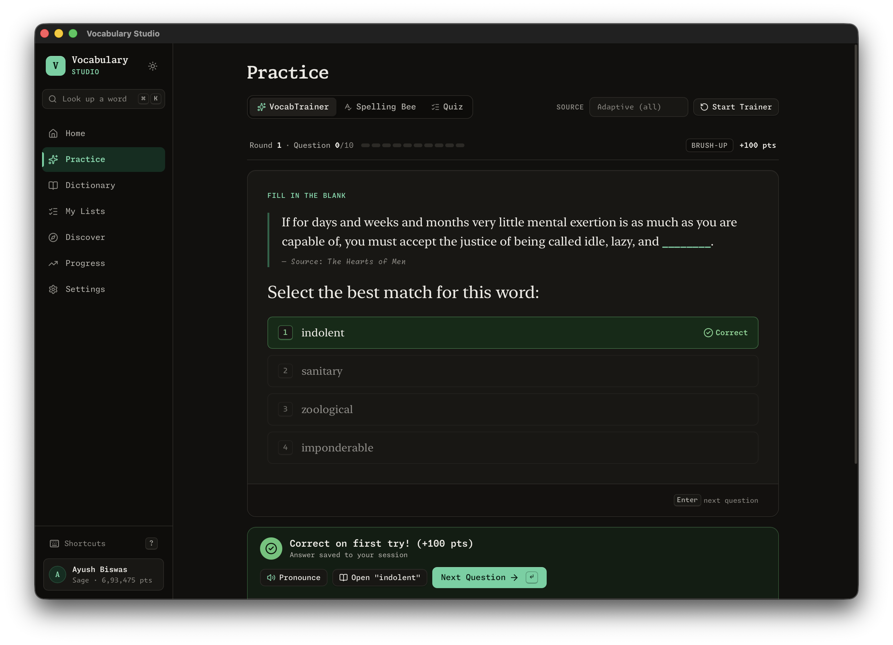

<div align="center">


<h1>Vocabulary Studio</h1>

<p><strong>Vocabulary.com, on your desktop.</strong></p>

<p>Practice, explore words, and keep your learning moving in one focused desktop app.</p>

<p>
  <a href="https://github.com/veryshyjelly/vocabulary-studio/releases/latest"></a>
  <a href="#install-on-macos"></a>
  <a href="https://github.com/veryshyjelly/vocabulary-studio/actions/workflows/release.yml"></a>
</p>

<p><a href="#install-on-macos">Install</a> · <a href="#your-learning-in-one-place">Explore features</a> · <a href="#for-developers">For developers</a></p>

</div>



## Install on macOS

**macOS 13 Ventura or later · Apple Silicon and Intel**

```sh
brew install --cask veryshyjelly/tap/vocabulary-studio
```

Open **Vocabulary Studio** from Applications or Spotlight and sign in with your
Vocabulary.com account. The app includes its fonts and frontend assets; you do
not need Go, Bun, Wails, a development server, or a `.env` file to use it.

> **First launch:** Builds are currently ad-hoc signed and are not notarized by
> Apple. If macOS blocks the app, attempt to open it, then go to **System Settings
> → Privacy & Security → Open Anyway**.

Prefer a direct download? Get the ZIP for your Mac from
[the latest release](https://github.com/veryshyjelly/vocabulary-studio/releases/latest),
unzip it, and drag **Vocabulary Studio.app** into **Applications**.

<details>
<summary>Updates, uninstalling, and switching from a local build</summary>

### Update

```sh
brew update
brew upgrade --cask vocabulary-studio
```

### Uninstall

```sh
brew uninstall --cask vocabulary-studio
```

Uninstalling keeps your settings and saved sessions.

### Already installed a local build?

Move the old app from `/Applications` or `~/Applications` to the Trash before
installing with Homebrew. This avoids existing-app conflicts and duplicate
Spotlight entries. Your settings and sessions are stored separately from the
app bundle.

</details>

## Your learning, in one place

| What you want to do | What you get |
| --- | --- |
| **Get more practice** | Adaptive VocabTrainer, practice from your lists, Spelling Bee, and quizzes, with hints and answer feedback. |
| **Get to know a word** | Definitions, US/UK pronunciation and audio, examples in context, synonyms, antonyms, and word families. |
| **Make a list your own** | Personal and public vocabulary lists, flashcards, list creation, and InstaList to extract vocabulary from a passage. |
| **Find something worth learning** | Curated collections, Word of the Day, and WordFinder for exploring word patterns. |
| **See where you stand** | Words you are learning, trouble words, mastered words, activity history, achievements, and leaderboards. |

Your home view brings together recent lists, lookups, study activity, and learning
in progress, so you can pick up where you left off.

### Made for your everyday study session

- **Keep your hands on the keyboard.** Open lookup with <kbd>⌘</kbd> + <kbd>K</kbd>,
  choose practice answers with <kbd>1</kbd>–<kbd>4</kbd>, and advance with <kbd>Enter</kbd>.
  Press <kbd>?</kbd> to see the shortcut reference.
- **Set the mood.** Choose light, dark, or system appearance, and American or
  British pronunciation.
- **Choose how sessions are saved.** Use the OS keychain, a restricted local
  file, or memory-only storage. Passwords, cookies, and tokens stay out of
  browser storage.

## For developers

Vocabulary Studio is built with **Go, Wails v3, React, and TypeScript**. This repo
also includes a **standalone, pure-Go Vocabulary.com SDK** and a CLI. The SDK
has no dependency on the desktop app or its frontend.

| Start here | What you will find |
| --- | --- |
| [Development guide](docs/DEVELOPMENT.md) | Prerequisites, source builds, packaging, tests, CLI usage, and visual previews. |
| [Go SDK](sdk/README.md) | Library usage, authentication, session persistence, and SDK development. |
| [Project structure](docs/ARCHITECTURE.md) | Module layout, dependency boundaries, and implementation notes. |
| [Release guide](docs/RELEASING.md) | macOS releases, signing, and automatic Homebrew cask updates. |

Packaged downloads are available for macOS. For native builds on other platforms,
start with the development guide; Windows and Linux releases are not currently
provided.
